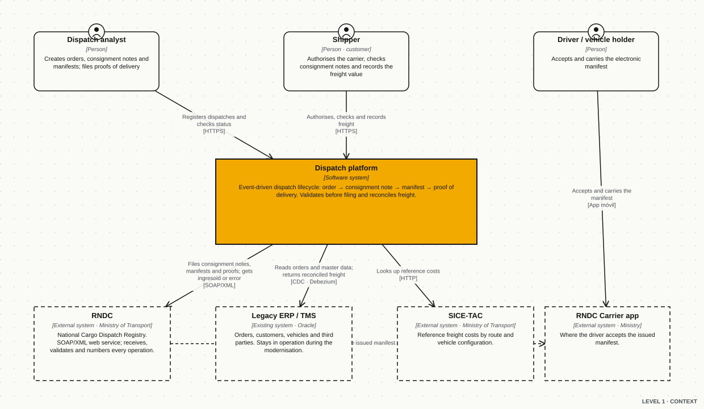
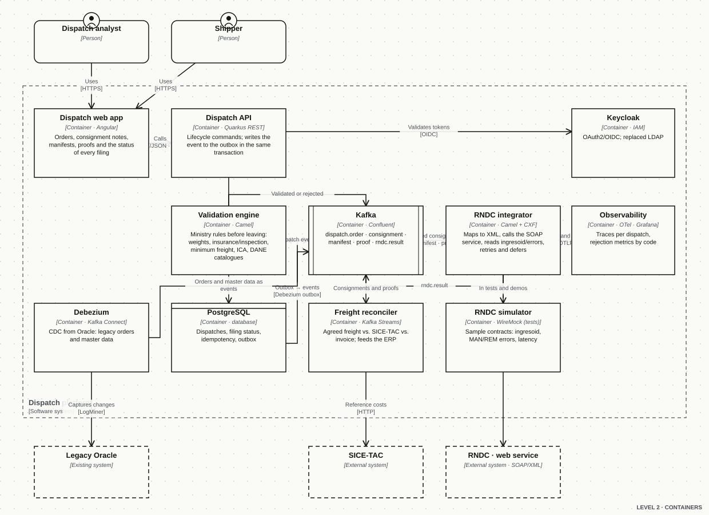
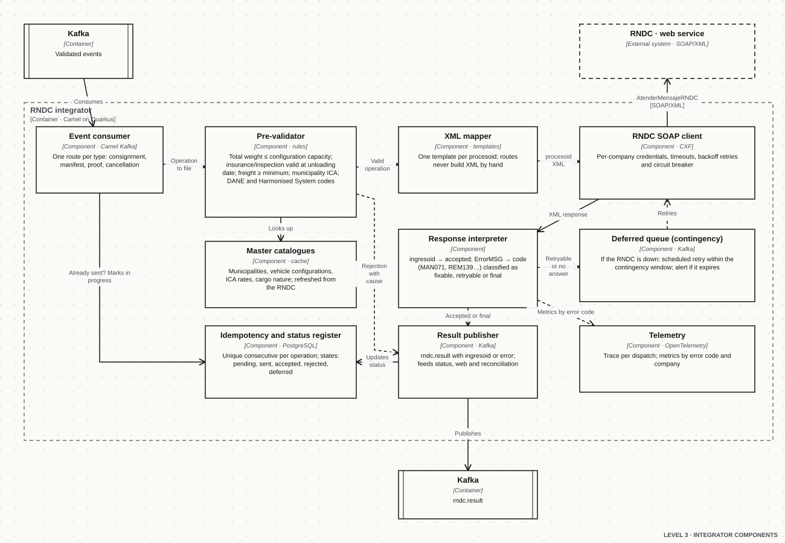
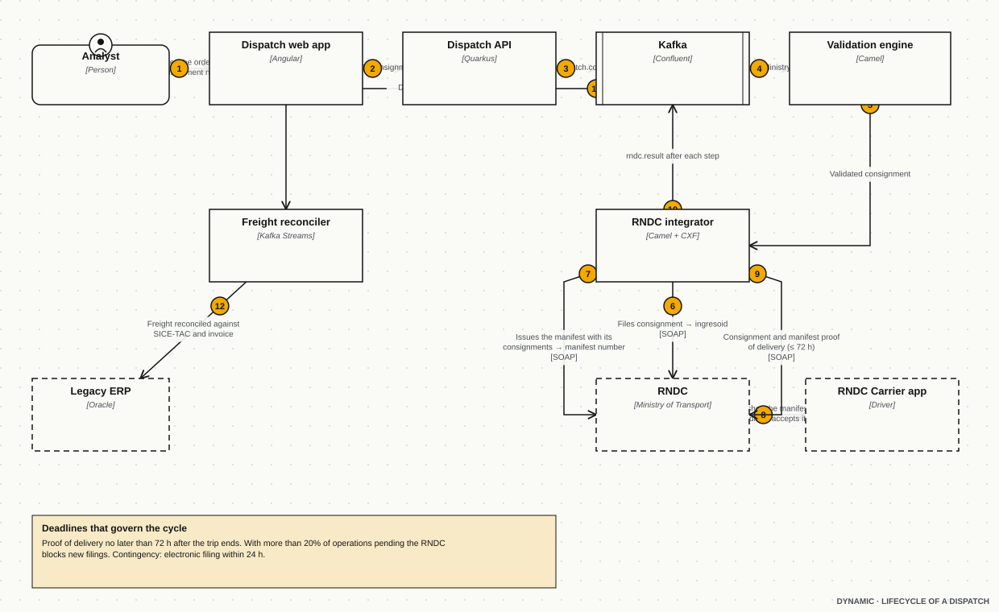
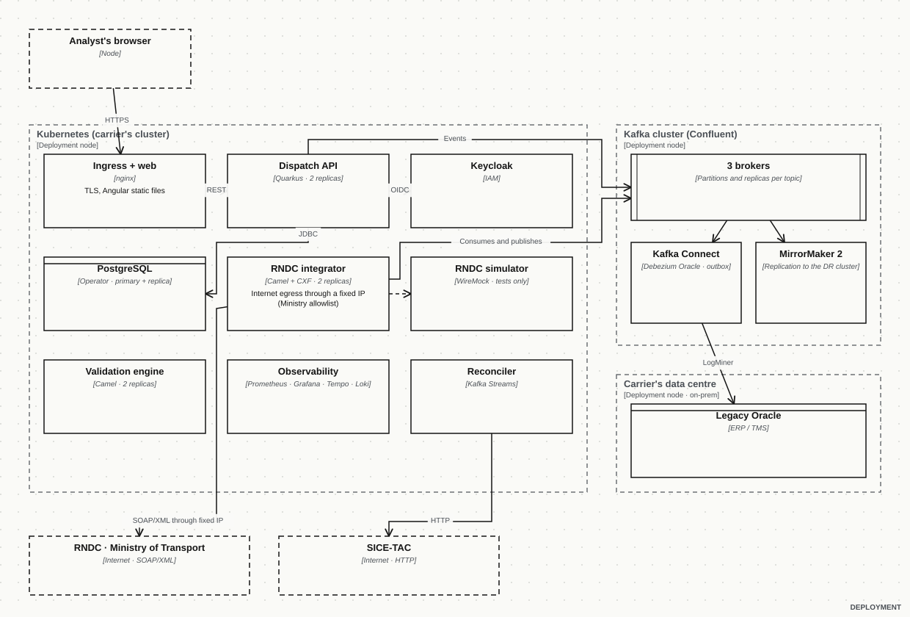

The RNDC (National Cargo Dispatch Registry) is the Ministry of Transport system where every land freight dispatch in Colombia must be reported: the **consignment note** (what is carried, from where to where and for whom), the **electronic cargo manifest** (which vehicle and driver carry those consignments) and the **proof of delivery**. For shippers and carriers I designed an event-driven dispatch lifecycle (order, consignment note, manifest, proof of delivery) with freight reconciliation on top, and modernised the surrounding Oracle/Java legacy with the Strangler Fig pattern and change data capture (CDC) instead of a big-bang rewrite.

This case study describes that architecture through a **simulated integration**: names, messages and diagrams belong to a generic carrier rather than a specific customer, and the web service codes and fields are shown as an illustrative example of the structure the Ministry publishes in its web service guide, not as a transcription of the current version.

## The problem

A freight carrier cannot move a truck without reporting to the RNDC, and the RNDC does not forgive disorder:

- Every operation has a deadline. The **proof of delivery** must be filed no later than **72 hours** after the trip ends.
- If more than **20%** of operations remain without a proof of delivery, the RNDC **blocks** the company from filing new ones. A slow system is not just slow: it leaves trucks parked.
- The Ministry validates against its own master data: the empty vehicle weight plus the consignments cannot exceed the configuration's capacity; mandatory insurance and the technical inspection must be valid on the unloading date (error codes such as MAN071 and MAN272); the ICA tax withholding must match the loading municipality's (MAN261); freight has a minimum; municipalities use DANE codes and goods the Harmonised System.
- A **manifest cannot be edited**: it is cancelled and reissued. Every mistake costs a round trip with the Ministry.
- If the RNDC platform is down the company operates in **contingency** and has a short window to file electronically what it dispatched.
- Electronic invoicing is cross-checked against consignments: each invoice line must equal the sum of its consignments' freight (FAC067), and consignments not invoiced in time also block.

All of this on top of an Oracle ERP/TMS with years of PL/SQL logic that could neither be switched off nor rewritten at once.

## Design constraints

1. **No big-bang rewrite.** The legacy stays the source of orders, customers, vehicles and third parties for as long as the transition lasts.
2. **Validate before filing.** The RNDC is the last line of validation, not the first; a Ministry rejection should be the exception.
3. **Nothing is lost or duplicated.** Every operation has a unique consecutive number and a state; a retry can never produce two consignment notes.
4. **24/7 operation with contingency.** If the RNDC goes down the company keeps dispatching and the system files later, within the allowed window and with evidence.
5. **Traceability per dispatch.** From the order to the proof of delivery and the invoice, with one trace per dispatch and metrics by error code.
6. **Ministry credentials per company**, never in code or messages.

## Architecture (C4 model)

### Level 1 · Context



The **dispatch platform** is the system being built. Around it are three people (the analyst who dispatches, the shipper who authorises and records freight, the driver who accepts the manifest in the Ministry's official app) and four systems: the **RNDC** (SOAP/XML web service), the **legacy ERP/TMS** on Oracle, **SICE-TAC** (reference freight costs) and the **RNDC Carrier app**.

### Level 2 · Containers



| Container | Technology | Responsibility |
| --- | --- | --- |
| Dispatch web app | Angular | Orders, consignment notes, manifests, proofs of delivery and the status of every RNDC filing |
| Dispatch API | Quarkus · REST | Lifecycle commands; writes the event to an **outbox** in the same transaction as the data |
| Validation engine | Apache Camel | Applies the Ministry's rules before the operation leaves the house |
| Kafka | Confluent | `dispatch.order`, `dispatch.consignment`, `dispatch.manifest`, `dispatch.proof`, `rndc.result` |
| RNDC integrator | Camel + CXF | Maps to XML, calls the SOAP service, interprets the answer, retries and defers |
| Freight reconciler | Kafka Streams | Agreed freight against SICE-TAC and the invoice; feeds the ERP |
| Debezium | Kafka Connect | Change data capture from Oracle: the legacy publishes without knowing it publishes |
| PostgreSQL | Database | Dispatches, filing status, idempotency register, outbox |
| Keycloak | IAM | OAuth2/OIDC; replaced the legacy LDAP |
| Observability | OpenTelemetry · Prometheus · Grafana · Tempo | One trace per dispatch; rejection metrics by code and company |
| RNDC simulator | WireMock | The test RNDC: same contracts, controlled answers and latency |

### Level 3 · RNDC integrator components



The integrator is a Camel application on Quarkus with one route per operation type. The happy path of a consignment note:

1. The **consumer** takes the validated event from Kafka and asks the **idempotency register** whether that consecutive was already sent. If it already has an `ingresoid`, it stops there.
2. The **pre-validator** repeats the Ministry's rules with the cached **master catalogues** (municipalities, vehicle configurations, ICA rates, cargo nature). Whatever fails is rejected with a cause, without spending a trip to the RNDC.
3. The **XML mapper** fills the template for the matching `procesoid`. Routes never concatenate XML by hand.
4. The **SOAP client** calls the service with the company's credentials, timeouts, backoff retries and a circuit breaker.
5. The **response interpreter** turns the answer into a result: `ingresoid` (accepted) or an error code classified as *fixable* (back to the web with the message), *retryable* (to the deferred queue) or *final*.
6. The **publisher** emits `rndc.result`; that updates the status, the web app and the reconciliation.

### Dynamic · the lifecycle of a dispatch



Order → validated consignment → filed consignment (`ingresoid`) → manifest issued with its consignments → the driver accepts it in the Ministry's app → trip → consignment and manifest proofs of delivery within 72 hours → freight reconciled against SICE-TAC and the invoice → the ERP receives the result. After every step the integrator publishes an `rndc.result`, so the analyst sees in the web app exactly where each dispatch stands and why.

### Deployment



Kubernetes for the platform containers (two replicas of the API, the engine and the integrator), a three-broker Kafka cluster with **MirrorMaker 2** replicating to a recovery cluster, Kafka Connect with the Debezium connector against the on-premise Oracle, and **internet egress through a fixed IP** because the Ministry authorises by allowlist. The simulator exists only in test environments.

All five diagrams are available in draw.io format to open and edit: [context](/casos/rndc/c1-contexto.en.drawio), [containers](/casos/rndc/c2-contenedores.en.drawio), [components](/casos/rndc/c3-componentes.en.drawio), [dynamic](/casos/rndc/c4-dinamica.en.drawio) and [deployment](/casos/rndc/c5-despliegue.en.drawio). They are generated from a single model by `scripts/rndc-diagramas.py` in the site's repository.

## Architecture decisions

| ADR | Decision | Why | Consequence |
| --- | --- | --- | --- |
| 01 | **Event-driven lifecycle with an outbox** | Every dispatch step (order, consignment, manifest, proof) matters to several consumers: validation, RNDC, reconciliation, web. One event per step decouples them and leaves a history. | The API writes data and event in the same transaction; Debezium publishes the outbox. There is never a "saved but not published". |
| 02 | **Strangler Fig + CDC over the legacy** | The Oracle ERP cannot be switched off. Debezium turns it into an event producer without touching its code. | The new platform is born reading from the legacy; every migrated function switches off one read. |
| 03 | **Validate locally with the Ministry's master data** | An RNDC rejection costs a full cycle and, accumulated, blocks the company. | Catalogues (DANE, configurations, ICA, cargo nature) are refreshed from the RNDC and cached; rules run before anything leaves. |
| 04 | **Idempotency by consecutive and a state machine** | Retries and contingency cannot duplicate consignments or manifests. | States `pending → sent → accepted / rejected / deferred`; the `ingresoid` closes the cycle; retries check the register before sending. |
| 05 | **Deferred queue for contingency** | The RNDC may not answer; the company must keep dispatching and file within the allowed window. | Unanswered operations move to a queue with scheduled retries and an alert before the window expires. |
| 06 | **RNDC simulator with WireMock** | Nobody should test against the Ministry. Sample contracts (accepted, each error family, high latency, outage) enable integration tests and reproducible demos. | Same integrator in every environment; only the URL and the credential change. |
| 07 | **Keycloak/OAuth2 instead of LDAP** | The new web app and API needed tokens, roles per company and federation. | One identity for analysts, shippers and services; the legacy joined as an OIDC client. |
| 08 | **Observability per dispatch** | "Why isn't this truck leaving?" has to be answered on one screen. | One trace per dispatch (OpenTelemetry) joining web, API, Kafka and integrator; metrics by error code and company in Grafana. |

## The simulation: what a filing looks like

Illustrative structure of a web service request, following the general shape the Ministry publishes (credentials, request type, process and variables); the exact field names and current codes live in the RNDC's official web service guide.

```xml
<root>
  <acceso>
    <username>COMPANY_USER</username>
    <password>********</password>
  </acceso>
  <solicitud>
    <tipo>1</tipo>            <!-- 1 = register, 2 = query -->
    <procesoid>3</procesoid>  <!-- land cargo consignment note (example) -->
  </solicitud>
  <variables>
    <NUMNITEMPRESATRANSPORTE>800000000</NUMNITEMPRESATRANSPORTE>
    <CONSECUTIVOREMESA>RM-2026-000421</CONSECUTIVOREMESA>
    <CODOPERACIONTRANSPORTE>G</CODOPERACIONTRANSPORTE>
    <CODNATURALEZACARGA>1</CODNATURALEZACARGA>
    <CANTIDADCARGADA>12500</CANTIDADCARGADA>
    <UNIDADMEDIDACAPACIDAD>1</UNIDADMEDIDACAPACIDAD>
    <CODMUNICIPIOORIGEN>05001000</CODMUNICIPIOORIGEN>
    <CODMUNICIPIODESTINO>11001000</CODMUNICIPIODESTINO>
    <!-- sender, recipient, loading and unloading appointments, goods… -->
  </variables>
</root>
```

Accepted answer: the Ministry returns an identifier that the platform stores as proof of the filing.

```xml
<root><ingresoid>3312877</ingresoid></root>
```

Rejected answer: a code and a message; the interpreter decides whether it is fixable, retryable or final.

```xml
<root><ErrorMSG>MAN071 The vehicle's technical inspection expires before the agreed unloading date</ErrorMSG></root>
```

The Camel route that orchestrates it, simplified:

```java
from("kafka:dispatch.consignment?groupId=rndc-integrator")
    .routeId("rndc-consignment")
    .idempotentConsumer(header("consecutive"), repo)        // never the same consignment twice
    .process(preValidator)                                   // weights, insurance/inspection, minimum freight, ICA, DANE
    .to("freemarker:templates/consignment.xml.ftl")         // procesoid XML
    .circuitBreaker()
        .to("cxf:bean:rndcClient?defaultOperationName=AtenderMensajeRNDC")
    .onFallback()
        .to("kafka:rndc.deferred")                           // contingency: scheduled retry
    .end()
    .process(responseInterpreter)                            // ingresoid or classified ErrorMSG
    .to("kafka:rndc.result");
```

And the simulator, a WireMock stub that answers like the RNDC when the consignment arrives with a vehicle whose inspection has expired:

```json
{
  "request": { "method": "POST", "urlPath": "/ws/rndcService",
               "bodyPatterns": [{ "contains": "<procesoid>3</procesoid>" }, { "contains": "VEHICLE_INSPECTION_EXPIRED" }] },
  "response": { "status": 200, "headers": { "Content-Type": "text/xml" },
                "body": "<root><ErrorMSG>MAN071 The vehicle's technical inspection expires before the agreed unloading date</ErrorMSG></root>",
                "fixedDelayMilliseconds": 800 }
}
```

## What changed for operations

- **Every filing is validated before it is sent** and traced end to end: the analyst sees the status and the cause of any rejection without calling anyone.
- Ministry rejections became the exception: weight, validity, ICA and minimum-freight rules are caught in house.
- Contingency stopped being a spreadsheet: deferred operations file themselves when the RNDC comes back and warn when the window is about to expire.
- Freight reconciliation (agreed, SICE-TAC, invoice) left the month-end close and joined the dispatch flow.
- The legacy kept operating during the migration, with no cut-over windows.

## What I would do differently today

- Publish the **simulator's contract as a specification** (OpenAPI/AsyncAPI plus the stubs) from day one, so the carrier's team can test without the integrator.
- Model the **contingency window as an SLO** with a Grafana alert from the start, not after the first block.
- Move the master catalogues into a **service of their own** with versioning and cut-off dates, shared by validation and reconciliation.

## Public sources

- Colombia's Logistics Portal, RNDC: regulations (Resolution 377 of 2013 and its updates), the RNDC manual and the guides for the web service, electronic manifest, consignment notes and proof of delivery.
- RNDC FAQ forums for carriers and shippers (deadlines, blocking causes, error codes, contingency).
