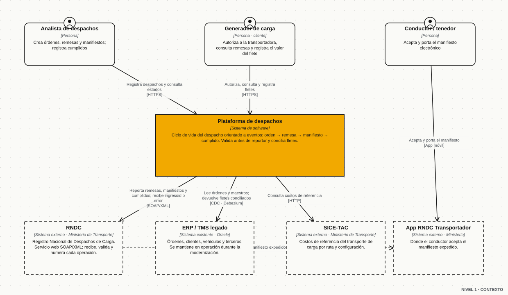
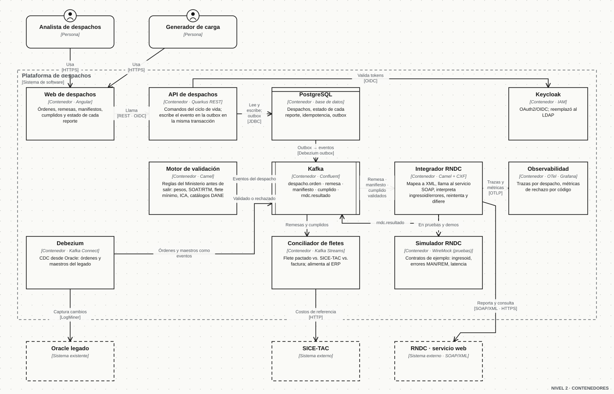
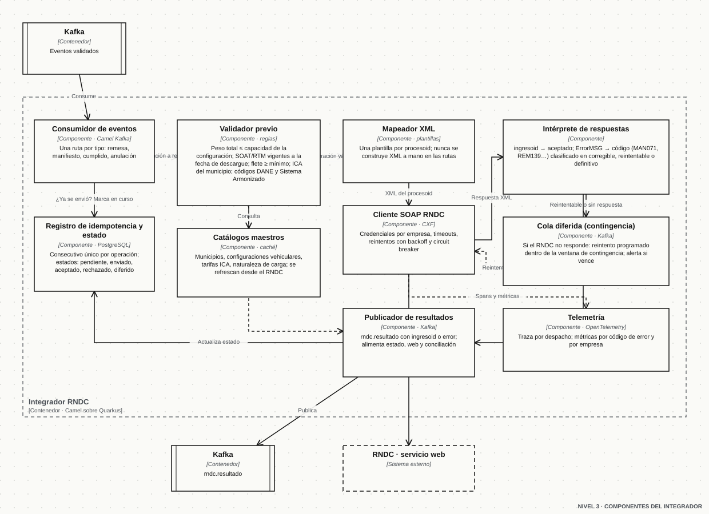
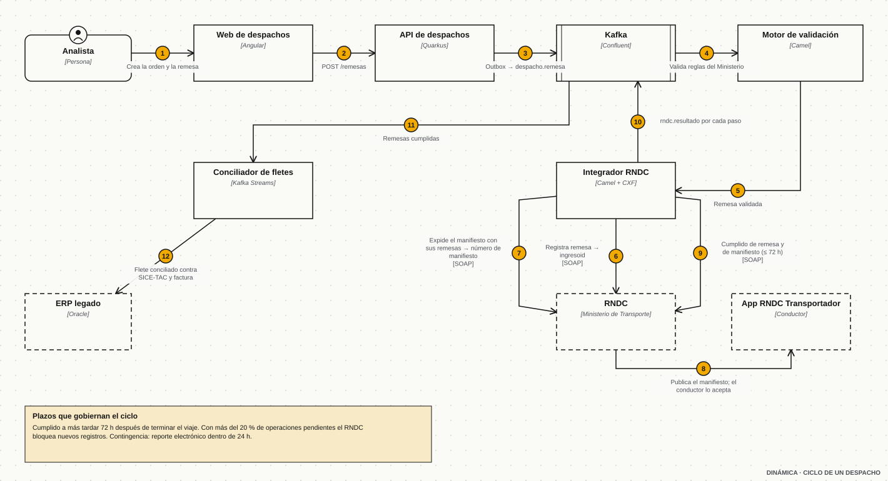
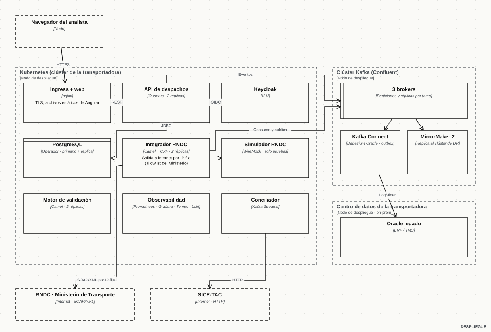

El RNDC (Registro Nacional de Despachos de Carga) es el sistema del Ministerio de Transporte donde debe reportarse cada despacho de carga terrestre en Colombia: la **remesa** (qué se transporta, de dónde a dónde y para quién), el **manifiesto electrónico de carga** (qué vehículo y conductor llevan esas remesas) y el **cumplido** (la entrega). Para empresas de carga diseñé un ciclo de vida orientado a eventos (orden, remesa, manifiesto, cumplido) con conciliación de fletes encima, y modernicé el legado Oracle/Java alrededor con Strangler Fig y captura de cambios (CDC) en lugar de una reescritura big-bang.

Este caso de estudio describe esa arquitectura con una **integración simulada**: los nombres, los mensajes y los diagramas son de un transportador genérico, no de un cliente concreto, y los códigos y campos del servicio web se muestran como ejemplo ilustrativo de la estructura que publica el Ministerio en su guía de servicio web, no como transcripción de la versión vigente.

## El problema

Una empresa de transporte de carga no puede mover un camión sin reportar al RNDC, y el RNDC no perdona el desorden:

- Cada operación tiene un plazo. El **cumplido** debe registrarse a más tardar **72 horas** después de terminar el viaje.
- Si más del **20 %** de las operaciones quedan pendientes de cumplir, el RNDC **bloquea** a la empresa para registrar nuevas. Un sistema lento no es sólo lento: deja los camiones parados.
- El Ministerio valida con sus propios maestros: el peso del vehículo vacío más las remesas no puede superar la capacidad de la configuración; el SOAT y la revisión técnico-mecánica deben estar vigentes a la fecha de descargue (errores tipo MAN071 y MAN272); la retención de ICA debe coincidir con la del municipio de cargue (MAN261); el flete tiene un mínimo; los municipios van en código DANE y la mercancía en el Sistema Armonizado.
- Un **manifiesto no se corrige**: se anula y se expide de nuevo. Cada error cuesta un viaje de ida y vuelta con el Ministerio.
- Si la plataforma del RNDC no responde, la empresa opera en **contingencia** y tiene una ventana corta para reportar electrónicamente lo que despachó.
- La facturación electrónica se cruza con las remesas: el valor de cada línea de factura debe coincidir con la suma de los fletes de sus remesas (FAC067), y las remesas sin facturar a tiempo también bloquean.

Y todo esto sobre un ERP/TMS en Oracle con años de lógica en PL/SQL que no se podía apagar ni reescribir de golpe.

## Restricciones de diseño

1. **Cero reescritura big-bang.** El legado sigue siendo la fuente de órdenes, clientes, vehículos y terceros mientras dure la transición.
2. **Validar antes de enviar.** El RNDC es la última línea de validación, no la primera; un rechazo del Ministerio debe ser la excepción.
3. **Nada se pierde ni se duplica.** Cada operación tiene un consecutivo único y un estado; un reintento nunca puede producir dos remesas.
4. **Operación 24/7 con contingencia.** Si el RNDC cae, la empresa sigue despachando y el sistema reporta después, dentro de la ventana permitida y con evidencia.
5. **Trazabilidad por despacho.** Desde la orden hasta el cumplido y la factura, con una traza por despacho y métricas por código de error.
6. **Credenciales del Ministerio por empresa**, nunca en el código ni en los mensajes.

## Arquitectura (modelo C4)

### Nivel 1 · Contexto



La **plataforma de despachos** es el sistema que se construye. A su alrededor hay tres personas (el analista que despacha, el generador de carga que autoriza y registra fletes, el conductor que acepta el manifiesto en la app oficial del Ministerio) y cuatro sistemas: el **RNDC** (servicio web SOAP/XML), el **ERP/TMS legado** en Oracle, **SICE-TAC** (costos de referencia del flete) y la **app RNDC Transportador**.

### Nivel 2 · Contenedores



| Contenedor | Tecnología | Responsabilidad |
| --- | --- | --- |
| Web de despachos | Angular | Órdenes, remesas, manifiestos, cumplidos y el estado de cada reporte ante el RNDC |
| API de despachos | Quarkus · REST | Comandos del ciclo de vida; escribe el evento en una **outbox** en la misma transacción que el dato |
| Motor de validación | Apache Camel | Aplica las reglas del Ministerio antes de que la operación salga de la casa |
| Kafka | Confluent | `despacho.orden`, `despacho.remesa`, `despacho.manifiesto`, `despacho.cumplido`, `rndc.resultado` |
| Integrador RNDC | Camel + CXF | Mapea a XML, llama al servicio SOAP, interpreta la respuesta, reintenta y difiere |
| Conciliador de fletes | Kafka Streams | Flete pactado frente a SICE-TAC y a la factura; alimenta al ERP |
| Debezium | Kafka Connect | Captura de cambios desde Oracle: el legado publica sin saber que publica |
| PostgreSQL | Base de datos | Despachos, estado de cada reporte, registro de idempotencia, outbox |
| Keycloak | IAM | OAuth2/OIDC; reemplazó al LDAP del legado |
| Observabilidad | OpenTelemetry · Prometheus · Grafana · Tempo | Una traza por despacho; métricas de rechazo por código y por empresa |
| Simulador RNDC | WireMock | El RNDC de pruebas: mismos contratos, respuestas y latencias controladas |

### Nivel 3 · Componentes del integrador RNDC



El integrador es una aplicación Camel sobre Quarkus con una ruta por tipo de operación. El camino feliz de una remesa:

1. El **consumidor** toma el evento validado de Kafka y pregunta al **registro de idempotencia** si ese consecutivo ya se envió. Si ya tiene `ingresoid`, termina ahí.
2. El **validador previo** repite las reglas del Ministerio con los **catálogos maestros** en caché (municipios, configuraciones vehiculares, tarifas de ICA, naturaleza de la carga). Lo que no pasa se rechaza con causa, sin gastar un viaje al RNDC.
3. El **mapeador XML** llena la plantilla del `procesoid` correspondiente. Las rutas nunca concatenan XML a mano.
4. El **cliente SOAP** llama al servicio con las credenciales de la empresa, timeouts, reintentos con backoff y un circuit breaker.
5. El **intérprete de respuestas** convierte la respuesta en un resultado: `ingresoid` (aceptado) o un código de error clasificado en *corregible* (vuelve a la web con el mensaje), *reintentable* (va a la cola diferida) o *definitivo*.
6. El **publicador** emite `rndc.resultado`; con eso se actualiza el estado, la web y la conciliación.

### Dinámica · el ciclo de un despacho



Orden → remesa validada → remesa registrada (`ingresoid`) → manifiesto expedido con sus remesas → el conductor lo acepta en la app del Ministerio → viaje → cumplido de remesa y de manifiesto dentro de las 72 horas → conciliación del flete contra SICE-TAC y la factura → el ERP recibe el resultado. En cada paso el integrador publica un `rndc.resultado`, así que el analista ve en la web exactamente en qué punto está cada despacho y por qué.

### Despliegue



Kubernetes para los contenedores de la plataforma (dos réplicas de API, motor e integrador), un clúster Kafka de tres brokers con **MirrorMaker 2** replicando a un clúster de recuperación, Kafka Connect con el conector Debezium contra el Oracle on-premise, y una **salida a internet por IP fija** porque el Ministerio autoriza por lista blanca. El simulador sólo existe en los entornos de prueba.

Los cinco diagramas están disponibles en formato draw.io para abrirlos y editarlos: [contexto](/casos/rndc/c1-contexto.es.drawio), [contenedores](/casos/rndc/c2-contenedores.es.drawio), [componentes](/casos/rndc/c3-componentes.es.drawio), [dinámica](/casos/rndc/c4-dinamica.es.drawio) y [despliegue](/casos/rndc/c5-despliegue.es.drawio). Se generan desde un solo modelo con `scripts/rndc-diagramas.py` en el repositorio del sitio.

## Decisiones de arquitectura

| ADR | Decisión | Por qué | Consecuencia |
| --- | --- | --- | --- |
| 01 | **Ciclo de vida orientado a eventos con outbox** | Cada paso del despacho (orden, remesa, manifiesto, cumplido) interesa a varios consumidores: validación, RNDC, conciliación, web. Un evento por paso desacopla y deja historia. | La API escribe dato y evento en la misma transacción; Debezium publica la outbox. Nunca hay "se guardó pero no se publicó". |
| 02 | **Strangler Fig + CDC sobre el legado** | El ERP Oracle no se puede apagar. Debezium lo convierte en productor de eventos sin tocar su código. | La plataforma nueva nace leyendo del legado; cada función que migra apaga una lectura. |
| 03 | **Validar localmente con los maestros del Ministerio** | Un rechazo del RNDC cuesta un ciclo completo y, acumulados, bloquean a la empresa. | Los catálogos (DANE, configuraciones, ICA, naturaleza) se refrescan desde el RNDC y viven en caché; las reglas se ejecutan antes de salir. |
| 04 | **Idempotencia por consecutivo y máquina de estados** | Reintentos y contingencia no pueden duplicar remesas ni manifiestos. | Estados `pendiente → enviado → aceptado / rechazado / diferido`; el `ingresoid` cierra el ciclo; los reintentos consultan el registro antes de enviar. |
| 05 | **Cola diferida para la contingencia** | El RNDC puede no responder; la empresa debe seguir despachando y reportar dentro de la ventana permitida. | Las operaciones sin respuesta pasan a una cola con reintento programado y una alerta antes de que venza la ventana. |
| 06 | **Simulador del RNDC con WireMock** | Nadie debe probar contra el Ministerio. Los contratos de ejemplo (aceptado, cada familia de error, latencia alta, caída) permiten pruebas de integración y demos reproducibles. | Mismo integrador en todos los entornos; sólo cambia la URL y la credencial. |
| 07 | **Keycloak/OAuth2 en lugar de LDAP** | La web y la API nuevas necesitaban tokens, roles por empresa y federación. | Una sola identidad para analistas, generadores y servicios; el legado se integró como cliente OIDC. |
| 08 | **Observabilidad por despacho** | "¿Por qué este camión no sale?" tiene que responderse en una pantalla. | Traza por despacho (OpenTelemetry) que une web, API, Kafka e integrador; métricas por código de error y por empresa en Grafana. |

## La simulación: cómo se ve un reporte

Estructura ilustrativa de una solicitud al servicio web, con la forma general que publica el Ministerio (credenciales, tipo de solicitud, proceso y variables); los nombres exactos de campos y códigos vigentes están en la guía oficial de servicio web del RNDC.

```xml
<root>
  <acceso>
    <username>USUARIO_EMPRESA</username>
    <password>********</password>
  </acceso>
  <solicitud>
    <tipo>1</tipo>            <!-- 1 = registro, 2 = consulta -->
    <procesoid>3</procesoid>  <!-- remesa terrestre de carga (ejemplo) -->
  </solicitud>
  <variables>
    <NUMNITEMPRESATRANSPORTE>800000000</NUMNITEMPRESATRANSPORTE>
    <CONSECUTIVOREMESA>RM-2026-000421</CONSECUTIVOREMESA>
    <CODOPERACIONTRANSPORTE>G</CODOPERACIONTRANSPORTE>
    <CODNATURALEZACARGA>1</CODNATURALEZACARGA>
    <CANTIDADCARGADA>12500</CANTIDADCARGADA>
    <UNIDADMEDIDACAPACIDAD>1</UNIDADMEDIDACAPACIDAD>
    <CODMUNICIPIOORIGEN>05001000</CODMUNICIPIOORIGEN>
    <CODMUNICIPIODESTINO>11001000</CODMUNICIPIODESTINO>
    <!-- remitente, destinatario, citas de cargue y descargue, mercancía… -->
  </variables>
</root>
```

Respuesta aceptada: el Ministerio devuelve un identificador que la plataforma guarda como prueba del registro.

```xml
<root><ingresoid>3312877</ingresoid></root>
```

Respuesta rechazada: un código y un mensaje; el intérprete decide si es corregible, reintentable o definitivo.

```xml
<root><ErrorMSG>MAN071 La revisión técnico-mecánica del vehículo vence antes de la fecha pactada de descargue</ErrorMSG></root>
```

La ruta Camel que lo orquesta, simplificada:

```java
from("kafka:despacho.remesa?groupId=integrador-rndc")
    .routeId("rndc-remesa")
    .idempotentConsumer(header("consecutivo"), repo)        // nunca dos veces la misma remesa
    .process(validadorPrevio)                                // pesos, SOAT/RTM, flete mínimo, ICA, DANE
    .to("freemarker:plantillas/remesa.xml.ftl")             // XML del procesoid
    .circuitBreaker()
        .to("cxf:bean:rndcClient?defaultOperationName=AtenderMensajeRNDC")
    .onFallback()
        .to("kafka:rndc.diferido")                           // contingencia: reintento programado
    .end()
    .process(interpreteRespuesta)                            // ingresoid o ErrorMSG clasificado
    .to("kafka:rndc.resultado");
```

Y el simulador, un stub de WireMock que responde como el RNDC cuando la remesa llega con un vehículo con RTM vencida:

```json
{
  "request": { "method": "POST", "urlPath": "/ws/rndcService",
               "bodyPatterns": [{ "contains": "<procesoid>3</procesoid>" }, { "contains": "VEHICULO_RTM_VENCIDA" }] },
  "response": { "status": 200, "headers": { "Content-Type": "text/xml" },
                "body": "<root><ErrorMSG>MAN071 La revisión técnico-mecánica del vehículo vence antes de la fecha pactada de descargue</ErrorMSG></root>",
                "fixedDelayMilliseconds": 800 }
}
```

## Qué cambió para la operación

- **Cada reporte se valida antes de enviarse** y queda trazado de punta a punta: el analista ve el estado y la causa de cualquier rechazo sin llamar a nadie.
- Los rechazos del Ministerio pasaron a ser la excepción: las reglas de peso, vigencias, ICA y flete mínimo se atrapan en casa.
- La contingencia dejó de ser una hoja de cálculo: las operaciones diferidas se reportan solas cuando el RNDC vuelve y avisan si se acerca el vencimiento.
- La conciliación de fletes (pactado, SICE-TAC, factura) salió del cierre de mes y entró al flujo del despacho.
- El legado siguió operando mientras se migraba, sin ventanas de corte.

## Qué haría distinto hoy

- Publicar el **contrato del simulador como especificación** (OpenAPI/AsyncAPI más los stubs) desde el primer día, para que el equipo de la transportadora pruebe sin el integrador.
- Modelar la **ventana de contingencia como un SLO** con alerta en Grafana desde el inicio, no después del primer bloqueo.
- Sacar los catálogos maestros a un **servicio propio** con versión y fecha de corte, compartido por validación y conciliación.

## Fuentes públicas

- Portal Logístico de Colombia, RNDC: normatividad (Resolución 377 de 2013 y sus actualizaciones), manual RNDC y guías de servicio web, manifiesto electrónico, remesas y cumplido.
- Foros de preguntas frecuentes del RNDC para empresas de transporte y generadores de carga (plazos, causales de bloqueo, códigos de error, contingencia).
